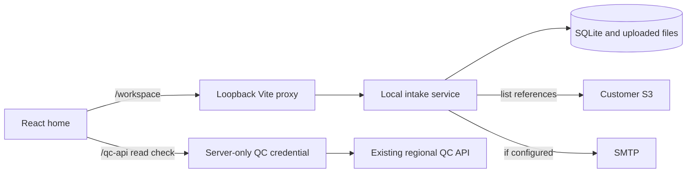

# Home-page project intake

## Context
Keep the first reference's cream/brown appearance and compact collapsible sidebar.
After naming a project, support S3, device or API intake, with invitations optional
and available later. User approved a separate intake/workspace service because the
QC API is reference-only, then supplied the live regional deployment.

## What we did
Added a persistent local workspace service and connected the home flow to it.
Configured a server-only proxy to the existing deployed QC API. Kept production
account/operator behavior unchanged. Added a deployment handoff with the actual
regional integration points.

## How
FastAPI streams device/API uploads to local storage and records SHA-256 metadata
in SQLite. Project upload keys and invitation tokens are hashed and expire. S3
uses real ListObjectsV2 with paging; credentials remain in process memory. Email
delivery is optional SMTP with truthful pending/failed/sent status. React persists
the selected project ID, reloads server metadata, and displays upload progress.

## Why
The QC control API must not receive media. Reusing its existing local video adapter
would start QC automatically; that is outside this upload step. A new project API
key is scoped to intake, rather than granting organization-wide QC access. Existing
regional team/identity should be reused in a production port; local project invites
do not pretend to be deployed account membership.

## Architecture

## Open questions
The provided sample credential is rejected by live sign-in and API reads (401).
Live S3/mail checks await configuration. Public deployment needs tenant/session
authorization, persistent Postgres/object storage, worker enrollment and a real
sign-in integration; the current intake is intentionally loopback-only. Browser
checks covered real local upload, invite-later, masked key generation and mobile
overflow. Ten backend tests and six client tests passed; build passed, with the
existing Dither ref lint warning unchanged. No production data was mutated.
