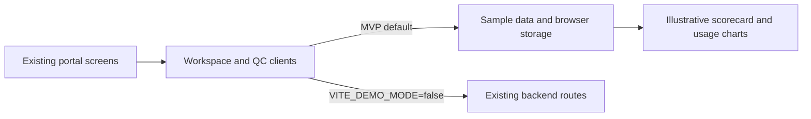

# MVP sample workspace

## Context
The user now explicitly wants random/sample content for the MVP, a darker brown
palette, minimal but spacious screens, and slightly larger home text. A follow-up
restores left alignment of the welcome heading and subtitle. This supersedes the
earlier decision to leave unavailable analysis/spending blank in the MVP.

## What we did
Added five sample projects, files, members, saved requirements, upload/QC key
metadata, daily hours and sample dollar charts, and component scorecards with
illustrative recommendations. Project creation, invitations, sample imports,
key generation, configuration, and requirements edits persist in the browser.
The sidebar is now #24170f and primary brown controls #3b2518. Centered the home
content column while keeping its welcome text left aligned; enlarged heading and
subtitle by 2px and increased spacing across cards and pages.

## How
Explicit demo mode is enabled by default for the MVP. Existing API clients dispatch
to a browser-local sample store; `VITE_DEMO_MODE=false` restores their original
network path. Storage and selected-project keys are separate from the real workspace.
The sample provider seeds once and retains changes across reloads. Scores respond
deterministically to files and weights; usage totals reconcile to the displayed runs.

## Why
A static Vercel frontend can demonstrate the whole flow without an available
production backend. Stable seeded data gives a coherent presentation rather than
changing every time a screen renders. A small demo label distinguishes the sample
workspace. Generated keys are visibly nonfunctional; file intake stores metadata
only, S3 uses sample references, invitations send no mail, and no charges occur.
Real API failures never silently switch to mock success.

## Architecture

## Open questions
Production authentication, durable uploads, QC execution and billing remain outside
this demo. Real integration must be completed before disabling demo mode publicly.
Seven focused demo tests cover persistence, isolation, no-network behavior, metadata
uploads/cancellation, invitations, nonfunctional keys, usage totals and score inputs.
The existing ten client tests still pass. No backend files were changed.
The production build and all 17 client tests pass. Browser checks confirmed seeded
projects, seven scorecard components, hours/spend charts, key metadata and zero
workspace/QC network requests. Home, Projects, Overview and Usage fit a 390px
viewport. The welcome text is left aligned with the card on desktop and mobile;
desktop heading/subtitle sizes are 40px/17px. Lint has only the existing Dither warning.
