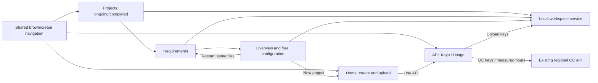

# Projects, API and dataset overview

## Context
The user supplied additional wireframes for API usage/keys, existing projects and
requirements, and a dataset overview. Preserve the established compact cream/brown
design and collapsible sidebar. Cover all prompts as one connected product flow.

## What we did
- Added hash navigation for Home, Projects, project requirements/files/uploads/
  overview/restart, and API Keys/Usage. Returning local-preview sessions land in
  Projects when projects exist; explicit page URLs survive refresh/back/forward.
- Kept project creation on Home. Projects supports search, ongoing/completed/all
  filters, joining by invitation, and explicit project completion/reopening.
- Added guided component/label/visual weights and free-form notes. Persisted
  requirements independently from uploaded files. Invitations remain available
  both during onboarding and inside existing projects.
- Added an overview of inventory, chosen files, target score and requirements.
  Configure persists a selection/goal for free; Overall/Section/Subsection/Line item
  groups the known inventory by dataset/type/folder/file. Restart retains files and
  opens requirements with a paid-rerun notice. New Project opens Home. JSON download
  exports a truthful inventory/configuration snapshot with analysis unavailable.
- Added clear upload-key metadata, named key generation and once-only masked/copyable
  secrets. The same API page is reachable from the sidebar, upload method and bottom
  prompt. Organization QC keys use the existing regional key endpoints.
- Added QC run usage, date windows, UTC daily-hour bars, search and pagination. The
  reference backend explicitly reports `prices_configured=False`; dollars are shown
  as unavailable, never as a fabricated zero or estimated charge.

## How
React reuses one navigation shell, invitation component and upload component. The
local service adds metadata tables for project status/requirements/configuration
and API-key names/creation/last use without replacing the existing tables. Legacy
projects default to ongoing and legacy keys retain their original hashes/expiry.
Only metadata is exposed in key lists. Configuration validates selected file IDs
against the project. Requirements validate ranges, label uniqueness and total share.

## Why
Organization QC usage cannot be honestly labeled project usage without a job-to-
project binding. Relative weights are not target scores. Available file metadata
cannot support claims about visual quality or dataset coverage. Preserve those
boundaries while implementing the requested pages and interactions.

## Architecture

## Open questions
This is not a completed production analysis/billing integration. The previously
supplied customer key was rejected (401); the local proxy also returned 502 during
UI verification. There is no binding from local project uploads/requirements to a
published QC job/report, and no priced spending timeline. The overview deliberately
shows unmeasured scores and no invented remediation analysis. Paid rerun execution,
billing and cloud-worker storage enrollment still require production integration.
Free configuration does not contact QC or billing. The existing sign-in remains a
local preview; sessionStorage remembers that preview, not a production identity.

Verification: build and 24 tests pass (10 TypeScript/client, 14 API). Browser checks
covered returning-user landing, saved requirements, target configuration, line-item
inventory, Restart retaining files/weights, named key generation and metadata after
refresh, completed filtering/reopening, and New Project returning to an empty Home
form. The downloaded JSON preserves the saved goal and uploaded file and explicitly
marks analysis unavailable. Mobile Projects, Requirements, Overview and API fit a
390px viewport. Only the pre-existing Dither ref warning remains in lint. No
production writes or charged jobs were made.
