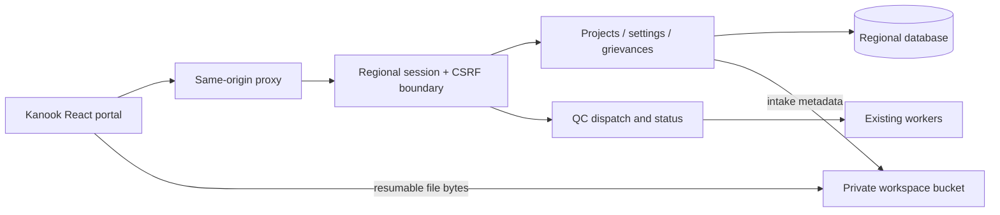

# Kanook portal integration and visual refinement

## Context
The user requested the deployed `kanook-0` API for login, job dispatch, docs,
settings, and a grievance form. Visual direction evolved from charcoal to the
latest dark brown/beige palette, with a minimal project-name form, white Kanook
wordmark, serif headings, and light/semibold body type.

## What we did
Connected session/CSRF-aware clients to the regional API; added login, account
settings, team controls, activity, generated API docs, grievance submission, and
project-linked dispatch/history/results. Prepared additive backend routes and
migration 16 in an isolated clone. Demo data is explicit rather than a silent
fallback when authentication fails.

Replaced the old stylesheet with the shared minimal theme. The sidebar has one
moving highlight, smooth collapse to `k.`, white branding and account/help text,
and light beige secondary copy. Home uses an underline input without an outer
card. Headings use Instrument Serif with tighter tracking. Body/control weights
use locally hosted Manrope 300/600 pending actual Gilroy assets.

## How
The portal proxy preserves browser identity and no longer injects shared keys.
Backend permissions, exact allowed origins, CSRF, project membership, and
idempotency are enforced at the existing regional boundary. Direct uploads use
GCS sessions; QC jobs retain the backend's manifest-reference contract. The
backend patch and release instructions live in `deploy/backend-portal.patch`
and `docs/BACKEND-CONNECTION.md`.

Validation: 22 frontend tests and ten regional integration tests passed, as did
the production build and whitespace check. Lint reports only the existing
`Dither.jsx` ref warning. Browser checks covered eleven routes at 375px, serif
heading styles, white account/help text, the 68px collapsed rail and its single
40px highlight. Fixed the API docs grid's mobile overflow during that check.
The exported backend patch passed reverse-apply validation against the clone.

## Why
Reusing the account boundary avoids a competing login system. Allowlisting the
frontend's exact origin preserves CSRF checks behind Vercel. Fake live scores,
automatic paid executions, and invented configuration endpoints were rejected.
Manrope provides the requested light/semibold contrast without claiming to ship
Gilroy, for which no font files were supplied. Instrument Serif and Manrope are
local assets so the visual result does not depend on a third-party font request.

## Architecture

## Open questions
No production deployment, migration, or paid dispatch was performed. The GCP
project/region and release configuration remain to be supplied. Automatic
conversion of intake files and UI preferences into enrolled dataset/spec
manifests is not part of the existing API contract. Support has persistence but
no operator triage screen. Production verification and real Gilroy font assets
remain separate follow-ups; local build, focused tests, and browser checks are
recorded in the index.
